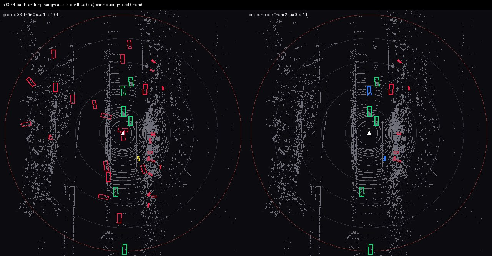

# Báo cáo Day 14 — Vi Thanh Đức — 2A202603051

- Mã học viên dùng với `--student`: `051`
- `seed_tag` trong `frames_A.txt`: `393590736f`

## 1. Dự đoán trước sweep (bước 5b)

Ghi **trước** khi chạy `scripts/pp_sweep.py`, rồi commit và push ngay (lịch sử commit là bằng chứng thời điểm viết). Không sửa phần này sau khi có kết quả.

- Tham số tôi nghĩ giảm công sửa nhiều nhất: `score_thr`, tăng từ 0,1 lên khoảng 0,3–0,4.
- Vì sao (nhìn ảnh BEV tập A: box thừa nhiều hay box sót nhiều?): Box thừa nhiều hơn hẳn box sót. Cấu hình gốc cần xóa 64, thêm 2, sửa 9 (chi phí 25,7), trong đó phần xóa chiếm 19,2. Trên ảnh s01f42 và s03f44 có nhiều box Cyclist và Car nằm ở bụi cây, hàng rào cây và dải cỏ. Trong 102 box dự đoán có 22 box score dưới 0,3 và 41 box dưới 0,4, nên tăng score_thr có thể bỏ được nhiều box thừa. Rủi ro là mất một số vật thật có score thấp, làm số box phải thêm tăng. Tôi dự đoán min_points ít tác dụng hơn vì chỉ có 4 trong 102 box chứa dưới 10 điểm LiDAR.

## 2. Tập A: sửa tay và tune

| Cấu hình | Xóa | Thêm | Sửa | Chi phí |
|---|---:|---:|---:|---:|
| Gốc |64 | 2 | 9 | 25,7|
| `best_config.json` | 12 | 8 | 7 | 15,1|

- Tham số đã đổi trong `best_config.json`: `score_thr` từ 0,1 lên 0,5; `min_points` giữ 0.
- Kết quả leave-one-out (dán các dòng `scripts/pp_sweep.py` in ra): 
  - s01f42: cấu hình chọn {'score_thr': '0.5', 'min_points': '0'} → 5.7 (tốt nhất có thể 5.7)
  - s03f44: cấu hình chọn {'score_thr': '0.5', 'min_points': '0'} → 4.1 (tốt nhất có thể 4.1)
  - s04f29: cấu hình chọn {'score_thr': '0.5', 'min_points': '0'} → 5.3 (tốt nhất có thể 5.3)
- Cấu hình có ổn định trên từng frame không? Vì sao tôi vẫn chọn (hoặc không chọn) nó: Trong phạm vi lưới đã thử, cấu hình ổn định. Cả 3 lượt leave-one-out đều chọn score_thr=0.5, min_points=0, và chi phí trên frame bỏ ra bằng mức tốt nhất có thể (5,7; 4,1; 5,3). So với gốc, chi phí giảm ở cả 3 frame (8,2 → 5,7; 10,4 → 4,1; 7,1 → 5,3). 
Tôi chọn cấu hình này vì tổng chi phí giảm từ 25,7 xuống 15,1, số box phải xóa giảm từ 64 còn 12 và số box phải sửa giảm từ 9 còn 7. Đổi lại, số box phải thêm tăng từ 2 lên 8, tức model bỏ sót nhiều vật hơn. Kết quả còn hạn chế: chỉ có 3 frame, score_thr=0.5 là mức cao nhất trong lưới nên chưa biết ngưỡng cao hơn ra sao, và ở score_thr=0.5 ba mức min_points cho chi phí bằng nhau.

## 3. Trước/sau (bước 8)

- `scripts/pp_compare.py` báo giảm 41%% công sửa trên tập A.
- Dự đoán ở mục 1 đúng hay sai? Giải thích bằng số box xóa/thêm/sửa: Đúng về tham số: tăng score_thr giảm công sửa nhiều nhất, còn min_points gần như không giúp thêm. Sai về khoảng giá trị: tôi dự đoán 0,3–0,4, nhưng 0,5 cho chi phí thấp hơn (15,1 so với 20,4 ở 0,3 và 18,9 ở 0,4, cùng min_points=0). Trên 3 frame, số box phải xóa giảm từ 64 còn 12, số box phải sửa giảm từ 9 còn 7, còn số box phải thêm tăng từ 2 lên 8, đúng với rủi ro đã nêu. Ví dụ frame s03f44: xóa giảm từ 33 còn 7, thêm tăng từ 0 lên 2, sửa giảm từ 1 còn 0, chi phí 10,4 → 4,1. Trong ảnh, nhiều box đỏ ở gốc đã biến mất, nhưng xuất hiện 2 box xanh dương (vật bị sót).

## 4. Tập B

Số đo từ `scripts/pp_prelabel.py --frames d14_<ID>/frames_B.txt --config d14_<ID>/best_config.json --gt d14_<ID>/ref_B.json`:

| Xóa | Thêm | Sửa | Chi phí |
|---:|---:|---:|---:|
| 32 | 20 | 9 | 34,1 |

- Loại box tốn công sửa nhất ở tập B: Box phải thêm, 20 box tương ứng 20,0 trên tổng chi phí 34,1 (xóa 9,6; sửa 4,5). Đối chiếu gần đúng theo khoảng cách tâm (dưới 1,5 m) giữa ref_B và pred_B, các box phải thêm gồm Cyclist 6, Truck 5, Pedestrian 4, Car 3, Bus 2.

## 5. Giới hạn

- Nêu ít nhất 2 giới hạn (ví dụ: chỉ 3 frame tune; model KITTI không có Truck/Bus; chi phí là công thức, chưa phải thời gian sửa thật): 
- Chỉ dùng 3 frame để tune, và score_thr=0.5 là mức cao nhất trong lưới nên chưa chắc đã tối ưu.
- Model học trên KITTI, không dự đoán trực tiếp Truck/Bus và còn sót Cyclist, Pedestrian.
- Chi phí 0,3·xóa + 1,0·thêm + 0,5·sửa là công thức của lab, không phải thời gian sửa thật.
- Nhãn tham chiếu do một người sửa, chưa được kiểm tra chéo.
